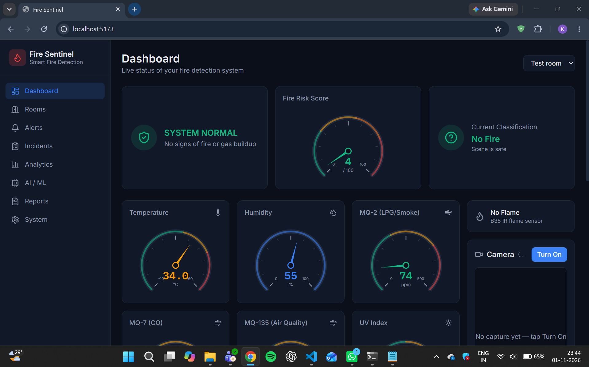
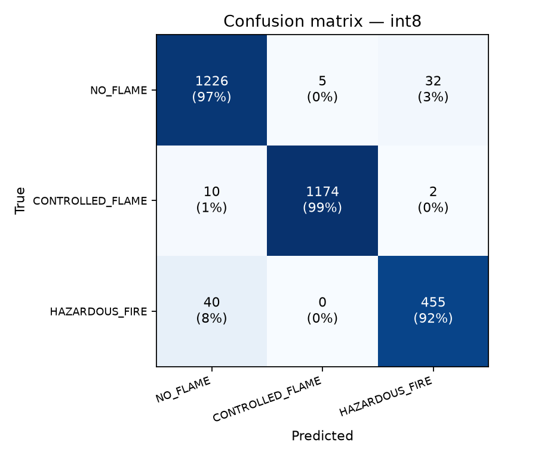
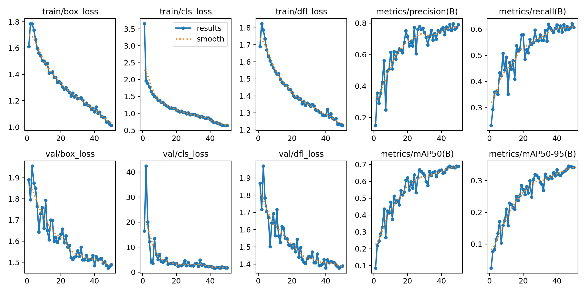

# Ignis 🔥

**Multi-sensor fire detection on an ESP32-S3, with on-device AI, a Flask backend and a React dashboard.**

Ignis (formerly *Fire Sentinel*, Prototype 2) watches a room with gas, flame, UV and climate sensors plus a camera. It decides the alarm state on the board itself, so it keeps working without WiFi. It classifies camera snapshots on the board with a quantized CNN and YOLO model, and sends readings, photos and alerts to a backend that drives a live web dashboard and Telegram/email notifications.

<!--
Screenshots: put PNG/JPG files in docs/images/ and uncomment, e.g.


-->

---

## Features

- **Sensor fusion on the edge.** MQ-2, MQ-7 and MQ-135 gas sensors, an IR flame sensor, a UV sensor and a BME280 combine into a 0–100 risk score that drives a state machine: `NORMAL → PRECURSOR → CONFIRMING → FIRE_CONFIRMED`.
- **On-device vision.** A MobileNetV2 CNN (INT8, 612 KB) labels each snapshot as `NO_FLAME`, `CONTROLLED_FLAME` or `HAZARDOUS_FIRE`. A YOLO11n detector (INT8, 160 px) draws flame boxes. Both models load from the microSD card.
- **Works offline.** The buzzer, OLED status screens and button acknowledge work without the network.
- **Backend.** Flask + SQLite store history, send Telegram and Gmail alerts by severity tier, analyse snapshots, and run a **simulated** fire-department dispatch countdown.
- **Dashboard.** React + Vite + Tailwind with live SVG gauges, risk score, on-demand camera, snapshot gallery, detection timeline, rooms and appliances, device setup, alert history, analytics and reports.
- **Zero-reflash device setup.** Boards register themselves with the backend. You assign rooms and override IPs from the dashboard.

> ⚠️ **Safety note:** the fire-department alert is a **simulation only**. Ignis never places a real emergency call. This is a student prototype, not a certified fire alarm.

## Architecture

```
  BME280 ─┐             ┌──────────── ESP32-S3 (Freenove WROOM CAM) ────────────┐
  ADS1115 ┼─ I2C ────►  │ core 1: sensors @1 Hz → window → fusion → state machine │
  (MQ-2/7/135, UV)      │         buzzer · OLED · button · camera · CNN + YOLO    │
  OLED ───┘             │ core 0: WiFi, HTTP uploads, device registration         │
  Flame DO ─ GPIO1      └──────────────────────────┬──────────────────────────────┘
                                                   │ WiFi / HTTP
                                                   ▼
                             Flask backend (SQLite) ── Telegram / Gmail alerts
                             ├─ risk scoring + gas-source hint
                             ├─ snapshot → hazard pipeline (CNN / YOLO)
                             ├─ simulated dispatch service
                             └─ REST API ───────────► React dashboard
```

## Repository layout

| Path | What it is |
|---|---|
| [`firmware/`](firmware/) | ESP32-S3 Arduino sketch (`esp32s3_cam_main/`), quantized `.tflite` models for the SD card, wiring diagram, [flashing guide](firmware/README_FLASHING.md) |
| [`backend/`](backend/) | Flask REST API, services (alerts, dispatch, hazard and ML inference), SQLite schema, tests. See [Backend README](backend/Backend_README.md) |
| [`dashboard/`](dashboard/) | React + Vite + Tailwind web dashboard. See [Dashboard README](dashboard/README.md) |
| [`fire_sentinel_ml_kit/`](fire_sentinel_ml_kit/) | Training, quantization and evaluation scripts for the CNN, YOLO and sensor models. See [ML README](fire_sentinel_ml_kit/README_ML.md) |
| [`Fire_Sentinel_P2_System_Reference.md`](Fire_Sentinel_P2_System_Reference.md) | Full system reference: wiring, GPIO map, firmware internals, API, database, ML |
| [`Fire_Sentinel_P2_Project_Report_Viva.pdf`](Fire_Sentinel_P2_Project_Report_Viva.pdf) | Project report |

## Hardware

| Part | Role |
|---|---|
| Freenove ESP32-S3-WROOM CAM (N16R8, OV3660) | Main board, camera, microSD |
| MQ-2 / MQ-7 / MQ-135 via ADS1115 | Smoke/LPG, CO, air-quality gas sensing |
| IR flame module | Direct flame detection (GPIO1) |
| UV sensor (ADS1115 A3) | Flame UV signature |
| BME280 | Temperature, humidity, pressure |
| SSD1306 OLED, passive buzzer, push button | Local status, alarm, silence/acknowledge |

Power: 5 V / 2 A USB-C adapter. The pin map, wiring and power notes are in [`firmware/README_FLASHING.md`](firmware/README_FLASHING.md) and [`firmware/Fire_Sentinel_Wiring_Diagram.pdf`](firmware/Fire_Sentinel_Wiring_Diagram.pdf).

## Quick start

### 1. Backend (Python 3.10+)

```bash
cd backend
python -m venv venv
venv\Scripts\activate            # macOS/Linux: source venv/bin/activate
pip install -r requirements.txt
copy env.example .env            # macOS/Linux: cp env.example .env; then fill in Telegram/Gmail values
python run.py                    # serves on http://0.0.0.0:5000
```

The SQLite database is created automatically on first run. `ultralytics` (for YOLO on the backend) is optional and a large download.

### 2. Dashboard (Node 18+)

```bash
cd dashboard
npm install
npm run dev                      # http://localhost:5173 (proxies /api to :5000)
```

### 3. Firmware

1. Copy `firmware/esp32s3_cam_main/secrets.h.example` to `secrets.h` and set your WiFi SSID and password.
2. Set `BACKEND_HOST` in `config.h` to the LAN IP of the PC running the backend.
3. Copy `fire_cnn_int8.tflite` and `fire_yolo_int8_160.tflite` from `firmware/` to the root of a FAT32 microSD card.
4. Flash with the Arduino IDE (esp32 core 3.x, ArduinoJson 7, OPI PSRAM, Huge APP partition). Full steps are in the [flashing guide](firmware/README_FLASHING.md).

The board registers itself within about 10 s. Assign it to a room on the dashboard's **System** page.

### Tests

```bash
cd backend
python -m unittest discover tests
```

## Model results

| Model | Size | Metric |
|---|---|---|
| CNN, MobileNetV2 α=0.35, 96×96, **INT8** | 612 KB | Test accuracy **96.98 %**, hazardous-fire recall **91.92 %**, false hazard alarm rate 1.4 % |
| CNN, FP32 (reference) | 1.57 MB | Test accuracy 97.76 %, hazardous-fire recall 91.52 % |
| YOLO11n fire detector (trained at 640 px, 50 epochs) | 2.9 MB INT8 @160 px | Validation precision 0.79, recall 0.61, mAP50 0.69, mAP50-95 0.34 |

<p align="center">
  
  
</p>

Training datasets are not included because of their size (about 2 GB). The scripts in `fire_sentinel_ml_kit/tools/` rebuild the splits from raw images. The YOLO dataset sources are listed in `fire_sentinel_ml_kit/ml/yolo/yolo_sources.json`.

## Known limitations

- Fusion weights and thresholds are hand-tuned. The sensor ML model was trained on synthetic data only, so the firmware ships with the rule-based fallback.
- MQ sensors are not gas-specific and drift with temperature, humidity and age. They need a 24–48 h burn-in.
- Failed uploads are dropped, not buffered.
- The camera proxy needs the backend on the same LAN as the board.
- Dispatch is simulated. Twilio call escalation is planned.

## Tech stack

ESP32-S3 · Arduino · TensorFlow Lite Micro · Python · Flask · SQLite · TensorFlow/Keras · Ultralytics YOLO11 · React · Vite · Tailwind CSS
